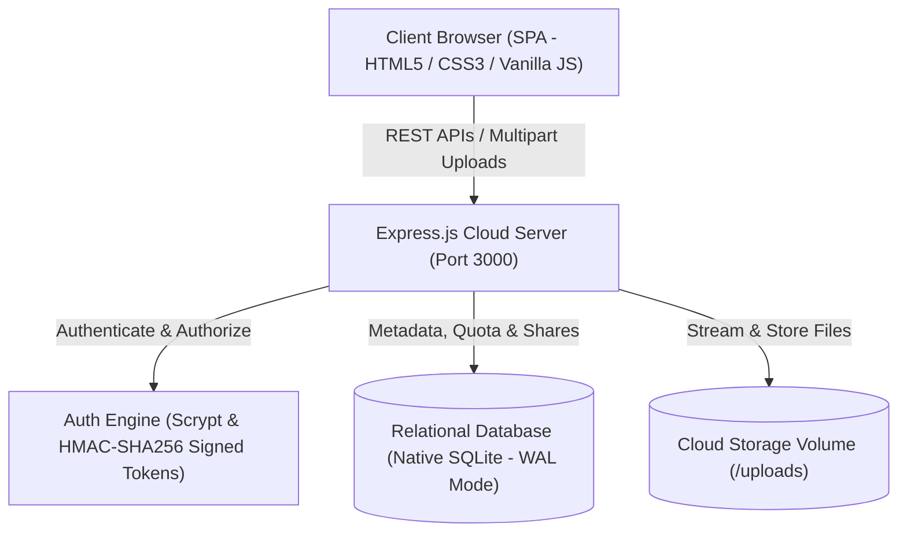

# SkyVault: Cloud-Based File Storage and Sharing System with User Authentication

SkyVault is an academic-grade, end-to-end cloud storage and file-sharing infrastructure. It incorporates **cryptographic user authentication**, **tenant-isolated cloud partitions**, **dynamic storage quota metering**, **real-time file streaming/previews**, **granular role-based sharing**, **password-protected expiring public links**, and an **audit activity logging trail**.

---

## 🌟 Key Architecture & Features

### 1. Robust Cryptographic Authentication
- **Secure Password Storage**: Uses Node.js native `crypto.scryptSync` with unique 16-byte cryptographically secure pseudorandom salts.
- **Signed HMAC-SHA256 Token Authentication**: Stateless bearer token authorization with expiration timestamps.
- **Pre-seeded Evaluation Accounts**:
  - `alice@cloud.io` (Password: `Password123!`)
  - `bob@cloud.io` (Password: `Password123!`)
- One-click **Quick Demo Login** for evaluation.

### 2. Cloud Partitioning & Storage Quotas
- **User-Isolated Storage**: Every user has their own private file catalog.
- **Live Quota Enforcement**: Dynamic 100 MB quota calculation per user with real-time percentage progress bar and upload size pre-checks.
- **Multi-format Support**: Documents, images, PDFs, media (audio/video), source code, and compressed archives.

### 3. File Management & Inline Previews
- **Drag-and-Drop Dropzone** with real-time upload progress tracking.
- **Color-coded Badges & Metadata**: Immediate detection of file types, formatted file size, and upload timestamps.
- **Inline Multi-Media Previewer**: Direct modal rendering of images, audio/video streaming, code highlighting, and PDF viewing.
- **File Organization**: Instant search (`Ctrl + K`), sorting (date, size, name), category filter chips, and starring/favoriting.

### 4. Advanced Collaboration & Sharing
- **Direct User-to-User Sharing**: Share files directly with any registered cloud user with configurable permissions (`Can Download` or `View Only`).
- **"Shared with Me" Workspace**: Dedicated section showing incoming shared documents with owner attribution.
- **Public Share Links**:
  - Cryptographically generated share tokens (`/#share/<token>`).
  - Optional passcode protection.
  - Configurable expiration (e.g. 24 hours, 7 days, or permanent).
  - Standalone guest portal for viewing or downloading shared files without needing an account.
- **Revocable Access**: Instantly revoke any direct or public share.

### 5. Audit Activity Log (Security Compliance)
- Full cryptographic audit trail tracking all actions: `LOGIN`, `UPLOAD`, `SHARE`, `DOWNLOAD`, `RENAME`, `DELETE`, and `REVOKE`.

---

## 📐 System Architecture Diagram



---

## 🚀 Quick Start Guide

### 1. Prerequisites
- **Node.js** (v18 or higher; tested on v24)
- **npm** (installed with Node)

### 2. Installation & Running

```bash
# 1. Install dependencies (Express & Multer)
npm install

# 2. Start the Cloud Server
npm start
```

### 3. Access the Cloud Dashboard
Open your web browser and navigate to:
```
http://localhost:3000
```

---

## 🧪 Quick Evaluation Steps for Examiners & Teachers

1. **Test Login**:
   - Click the quick button **"Log in as Alice (alice@cloud.io)"**.
2. **Test File Upload & Quota**:
   - Drag & drop any image, document, or code file into the dropzone.
   - Observe the live storage quota meter update immediately.
3. **Test Previews & Starring**:
   - Click the file card to view the inline preview modal.
   - Click the star icon to prioritize the file.
4. **Test Direct Sharing**:
   - Click the **Share** button on the file.
   - Enter `bob@cloud.io` and click **Share with User**.
5. **Test Public Link Sharing**:
   - Switch to the **Public Web Link** tab in the share modal.
   - Click **Generate Secure Link** and click **Copy**.
   - Open that URL in a new tab to test guest access.
6. **Verify Shared Workspace**:
   - Log out and click **"Log in as Bob (bob@cloud.io)"**.
   - Navigate to the **"Shared with Me"** tab in the sidebar to verify the file sent by Alice is accessible.
7. **Verify Audit Trail**:
   - Click **Audit Activity Log** to inspect the chronological trail of operations.

---

## 🗄️ Database Schema

The database (`cloud_storage.db`) uses four normalized tables:

1. **`users`**:
   - `id`, `name`, `email` (UNIQUE), `password_hash`, `salt`, `quota_bytes`, `created_at`
2. **`files`**:
   - `id`, `user_id` (FK), `filename`, `stored_name`, `mime_type`, `size`, `is_starred`, `created_at`, `updated_at`
3. **`shares`**:
   - `id`, `file_id` (FK), `owner_id` (FK), `shared_with_email`, `permission`, `share_token`, `is_public`, `password_hash`, `expires_at`, `created_at`
4. **`activities`**:
   - `id`, `user_id` (FK), `action`, `details`, `timestamp`

---

## 📡 REST API Reference

| Method | Endpoint | Description | Auth Required |
|---|---|---|---|
| `POST` | `/api/auth/register` | Register a new user | No |
| `POST` | `/api/auth/login` | Authenticate user & get signed token | No |
| `GET` | `/api/auth/me` | Get profile & live storage quota | Yes |
| `GET` | `/api/files` | List current user's files & storage stats | Yes |
| `POST` | `/api/files/upload` | Upload file with quota pre-check | Yes |
| `GET` | `/api/files/:id/download` | Download file (verifies owner/share) | Yes |
| `GET` | `/api/files/:id/preview` | Stream file for inline preview | Yes |
| `PATCH` | `/api/files/:id/star` | Toggle star/favorite status | Yes |
| `PATCH` | `/api/files/:id/rename` | Rename file | Yes |
| `DELETE`| `/api/files/:id` | Delete file from DB & disk storage | Yes |
| `POST` | `/api/files/:id/share` | Create direct or public share | Yes |
| `GET` | `/api/files/:id/shares` | List active shares for file | Yes |
| `DELETE`| `/api/shares/:id` | Revoke a share | Yes |
| `GET` | `/api/files/shared-with-me` | Get files shared with user | Yes |
| `GET` | `/api/public/share/:token` | Fetch public share metadata | No |
| `GET` | `/api/public/share/:token/download` | Download public file (passcode check) | No |
| `GET` | `/api/activities` | Fetch audit security trail | Yes |

---

## 🎓 Viva / Presentation Questions & Answers

**Q1: How does this project implement multitenancy and tenant isolation?**  
*Answer*: Each user has their own unique `user_id`. Queries strictly filter files by `WHERE user_id = ?`. Even when a file is shared, the database enforces permissions through foreign-key mapped share records, preventing any unauthorized cross-tenant data access.

**Q2: How is password security managed?**  
*Answer*: Passwords are never stored in plaintext. We utilize Node's native `scrypt` hashing algorithm with unique cryptographic salts per user. When verifying passwords, constant-time comparison (`crypto.timingSafeEqual`) is utilized to guard against timing attacks.

**Q3: How are storage quotas calculated and enforced?**  
*Answer*: Each user account has an allocated storage quota (e.g. 100 MB). Upon upload, Multer receives the file and the server checks `current_used + incoming_size > quota_bytes`. If exceeded, the temporary file is unlinked immediately and an HTTP 400 error is returned with quota details.

**Q4: How does public link expiration and protection work?**  
*Answer*: When a public share link is created, a unique crypto-random token is generated with an optional `expires_at` timestamp and optional password hash. Any guest accessing `/api/public/share/:token` has their request validated against expiration and password criteria before any file stream is permitted.

---

## 📁 Repository Structure (Under 10 Files Constraint)

```
Final_Project/
├── .gitignore          # Git exclusion rules
├── package.json        # Dependencies & launch scripts
├── package-lock.json   # Exact dependency locks
├── auth.js             # Password hashing & HMAC token signing
├── db.js               # SQLite database schemas & seed data
├── server.js           # Express cloud backend server & REST API
├── README.md           # Documentation & Viva presentation guide
├── uploads/            # Cloud file storage partition directory
└── public/             # Single-Page Web Application
    ├── index.html      # Responsive HTML5 layout
    ├── styles.css      # Obsidian dark/light design system
    └── app.js          # Cloud drive UI interactions & API client
```
